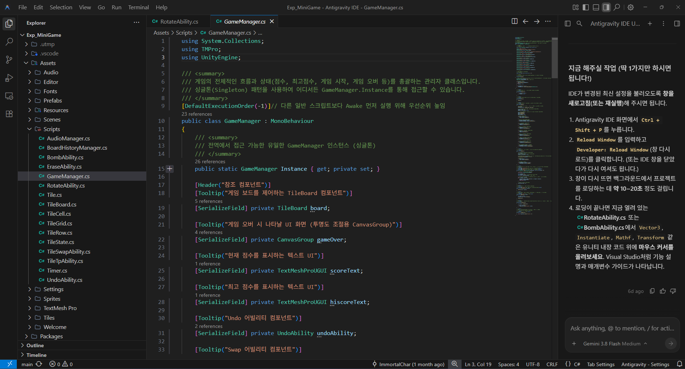

난 평소 에디터로 Antigravity IDE를 사용하고 있다.
그냥 남들이 다 VS Code를 쓰길래 아무 생각 없이 썼는데, 쓰다보니 내장된 AI인 Github Copilot가 너무 별로고 이 것의 유료 버전을 쓰자니 호환성이 너무 안 좋은 것 같았다. 그래서 찾아보다 보니 마침 Gemini Pro 구독을 하고있고 VS Code의 포크로 만든 이 에디터가 가장 좋을 것 같다고 판단해서 옮기게 됐다.
다만 그 누구한데도 VS Code라는 에디터에 대해서 배우지 않았고 이거저거 눌러보다가 UI가 바뀌고 원복하는 법도 몰라 AI와 씨름했던 적이 많아서 이거저거 건드려보기가 아직도 무서운 상태다. 그나마 최근에 호기심에 눌러보다가 우측 상단에 최소화 버튼 왼쪽에 있는 아이콘을 건드리면 특정 부분에 대한 노출을 활성화/해제 할 수 있다는 걸 최근에야 알았다.
평소에 에디터를 비좁은 크기로 쓰고 있다가 저 기능이 있다는 걸 알았을때는 꽤 충격이었다. 사실 왼쪽 파일 목록이나 우측 AI 에이전트는 상시로 켜놔야 해서 별로 상관이 없지만 하단 패널의 경우 필요 없을 때가 더 많아서 요새는 어지간하면 끄고 사용하고 간혹 터미널이 필요한 경우만 잠깐 키는 식으로 사용 중이다.
사실 이런 앱들을 사용하다 보면 크게 느끼는 것 중 하나가 누가 알려주지 않으면 어떤 기능이 어떤 UI 속에 있는지 알기가 어렵다는 것이다. 좌측 상단에 보면 File, Edit, Seletcion 등등 있지만 내가 생각한 기능이 저기 있을까? 하면 막상 못 찾는 경우가 대부분이다.
내가 하는 게임인 워프레임의 경우 설정 UI에 검색 기능을 달아서 이 설정이 있나? 하고 검색해볼 수 있는 기능이 있는데, 불친절한 앱들을 쓰다보면 저 기능이 계속 생각이 난다. 어떤 에디터든 이런 기능이 좀 필요하지 않나 싶다. 기능을 하나하나 외우는 건 너무 피곤한 일이기 때문이다.